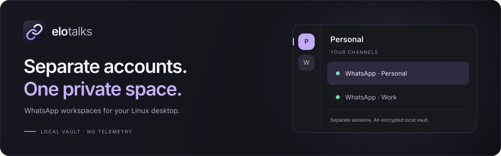

<p align="center">
  <a href="https://github.com/ItsAnunesS/elo-talks/releases/latest">Download</a> ·
  <a href="docs/SECURITY.md">Security</a> ·
  <a href="CONTRIBUTING.md">Contributing</a> ·
  <a href="https://github.com/ItsAnunesS/elo-talks/issues">Report an issue</a>
</p>

# Elo Talks

A Linux desktop app for managing multiple WhatsApp accounts in one place. Organize
personal and work accounts into workspaces, keep them connected in the background,
and protect their local profiles with an encrypted vault.

Built with **Tauri 2, Rust and WebKitGTK**. No account with Elo Talks, no application
backend, no telemetry.

## What it does

- **Workspaces and channels.** Group accounts into categories, pin favorites and
  filter channels with unread activity.
- **Separate sessions.** Each account has its own browser context and persistent
  profile. Switching channels keeps other accounts running.
- **Local protection.** Unlock with a master password, an optional device PIN or a
  compatible FIDO2 key. Account processes stop before the vault is unmounted.
- **Desktop notifications.** Choose private alerts, channel names or message
  previews. Pause notifications globally or mute individual accounts.
- **Verified updates.** A bundled launcher checks for updates before opening the
  app. During use, updates prepare in the background and wait for you to restart.
- **Keyboard-friendly navigation.** Search channels with `Ctrl+K`, adjust text size
  and density, and respect the system's reduced-motion setting.

## Get started

1. Download the **Linux x86_64 AppImage** from [Releases](https://github.com/ItsAnunesS/elo-talks/releases/latest).
2. [Verify its signature and checksum](docs/SECURITY.md#distribution), make the file
   executable, and open it.
3. Create a master password, add a WhatsApp channel, and link it by scanning the QR
   code from WhatsApp on your phone.

Keep your master password safe. There is no server-side recovery if you lose all
enrolled unlock methods.

**Platform status:** Fedora 44 and Ubuntu 24.04 are the target systems. Clean-system
validation is still pending; a published AppImage is not a compatibility or
security certification. See [validation status](docs/VALIDATION.md).

## Everyday use

Closing the window keeps accounts running when a supported tray is available.
Use **Quit** to exit. Screen lock, session inactivity and suspension request vault
closure; if closure fails, the app shows recovery instead of claiming it is locked.

Enable notifications in WhatsApp as well as Elo Talks. Unread badges use WhatsApp's
counter when available, with a notification-based fallback. They are not guaranteed
message totals. Notification previews may remain in your desktop's history.

The startup launcher offers **Open current version** if an update fails. Background
check intervals are configurable in Settings. Gear Lever and compatible AppImage
managers can also discover updates through embedded zsync metadata; that does not
mean those managers verify Sigstore signatures.

## Security boundaries

Profiles are stored in a gocryptfs vault. Remote WhatsApp views receive no Tauri
capabilities, and each account uses an isolated WebKit context.

An unlocked vault cannot protect against a compromised operating system. Exported
attachments, desktop notification history and unprotected swap are outside its
protection. Voice and video calls are not supported.

Read the [security model](docs/SECURITY.md) for details and limitations. The
[0.4 release notes](docs/RELEASE-0.4.md) describe the current hardening work.

## Development

Use the pinned Rust toolchain and lockfiles. Native builds require GTK3,
WebKitGTK 4.1, libfido2, D-Bus and the packaging tools listed in the
[release workflow](.github/workflows/release.yml). The local interface uses HTML,
CSS and JavaScript with no runtime npm dependencies.

```sh
npm ci --ignore-scripts
cargo test --locked
npm run format:check
npm run test:ui
python3 -m unittest discover -s tests -v
```

Browser tests require Playwright Chromium. Run `go test ./...` from `updater/`
for the updater suite. Native tests use isolated graphical sessions and synthetic
data; they do not replace testing on supported systems.

| Directory | Purpose |
| --- | --- |
| `src-tauri/src/` | Controller, launcher, vault and native integrations |
| `ui/` | Local interface and account navigation |
| `updater/` | Download, verification and AppImage replacement |
| `tests/` | Browser regressions and repository checks |
| `scripts/` | Build, packaging and release tooling |

See [Contributing](CONTRIBUTING.md), [agent guidelines](AGENTS.md) and
[release instructions](docs/RELEASING.md) before submitting changes.

## License

[MIT](LICENSE). Published by **AnunesS**.

Elo Talks is an independent project and is not affiliated with WhatsApp or Meta.
WhatsApp is a trademark of its owner.
